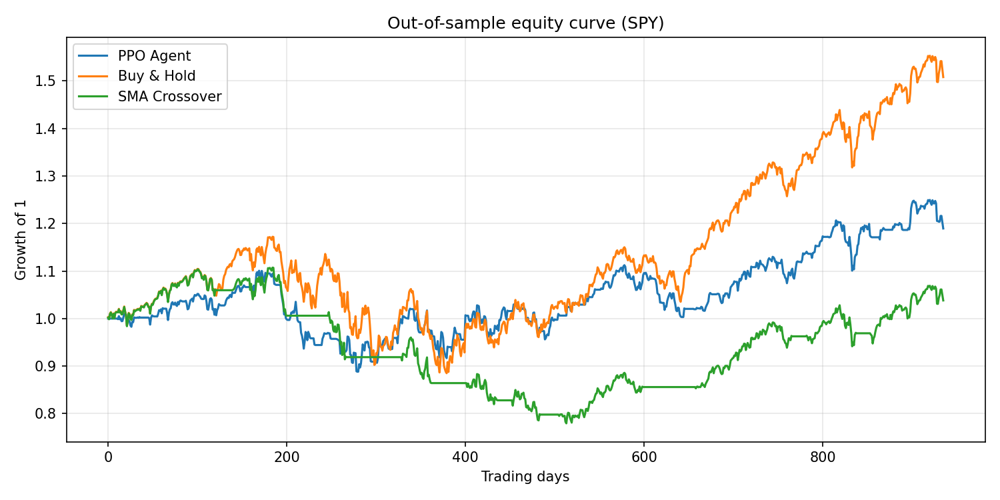

# RL Trading Agent (PPO) vs Buy-and-Hold

A reinforcement learning trading agent built with a custom Gymnasium environment and Stable-Baselines3 PPO, evaluated out-of-sample against Buy-and-Hold and an SMA crossover baseline.

## Goal

Test whether an RL agent can learn a trading policy that beats simple baselines after accounting for transaction costs, using strict train/test separation to avoid look-ahead bias.

## Approach

**Data**: Daily OHLCV for SPY (2012-2024) via `yfinance`.

**Features**: Daily returns, RSI(14), MACD (normalized), 20-day rolling volatility, volume change. Normalized using training-set statistics only.

**Environment** (custom Gymnasium env):
- **State**: last 30 days of features + current position
- **Actions**: Hold / Buy (go long) / Sell (go flat)
- **Reward**: position x next-day return - transaction cost
- **Transaction cost**: 0.1% per position change

**Algorithm**: PPO (Stable-Baselines3, MLP policy), 200k timesteps.

**Evaluation**: Chronological split, first 70% for training and last 30% for testing (no random shuffling, no leakage).

**Baselines**: Buy-and-Hold, SMA(20/50) crossover (with the same transaction costs).

## Results (out-of-sample)

| Strategy | Total Return % | Sharpe | Max Drawdown % | Win Rate % |
|---|---|---|---|---|
| PPO Agent | XX.XX | X.XX | -XX.XX | XX.XX |
| Buy & Hold | XX.XX | X.XX | -XX.XX | XX.XX |
| SMA Crossover | XX.XX | X.XX | -XX.XX | XX.XX |

*(Replace with the numbers from `results.csv` after running.)*

### Equity curve



## Run it

```bash
git clone https://github.com/<your-username>/rl-trading-agent.git
cd rl-trading-agent
pip install -r requirements.txt
python rl_trading_agent.py
```

Outputs: `results.csv` and `equity_curve.png`.

To change the asset, edit `TICKER` in `rl_trading_agent.py` (e.g. `"^NSEI"` for NIFTY 50).

## Limitations

- Daily data and a simple long/flat strategy; no shorting or position sizing.
- Single asset, single train/test split. Results can vary across random seeds.
- Costs are modeled as a flat percentage; no slippage or market impact.
- Past performance does not imply future results. This is an educational project, not financial advice.

## Future work

- Walk-forward validation across multiple windows
- LSTM/Transformer price-prediction signal as an additional RL state feature
- Multi-asset portfolio allocation
- Multiple seeds with confidence intervals

## Tech stack

Python, pandas, NumPy, Gymnasium, Stable-Baselines3, PyTorch, matplotlib, yfinance
